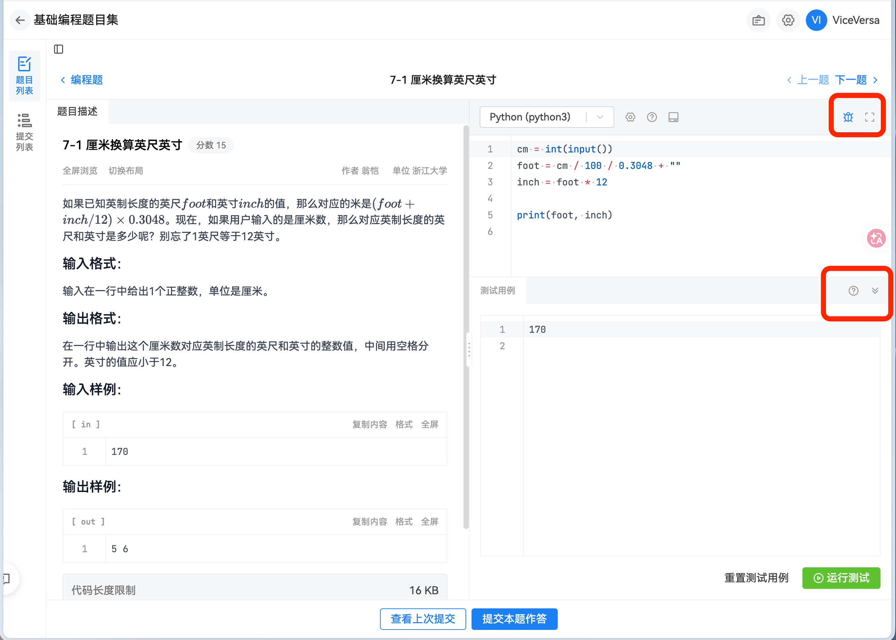
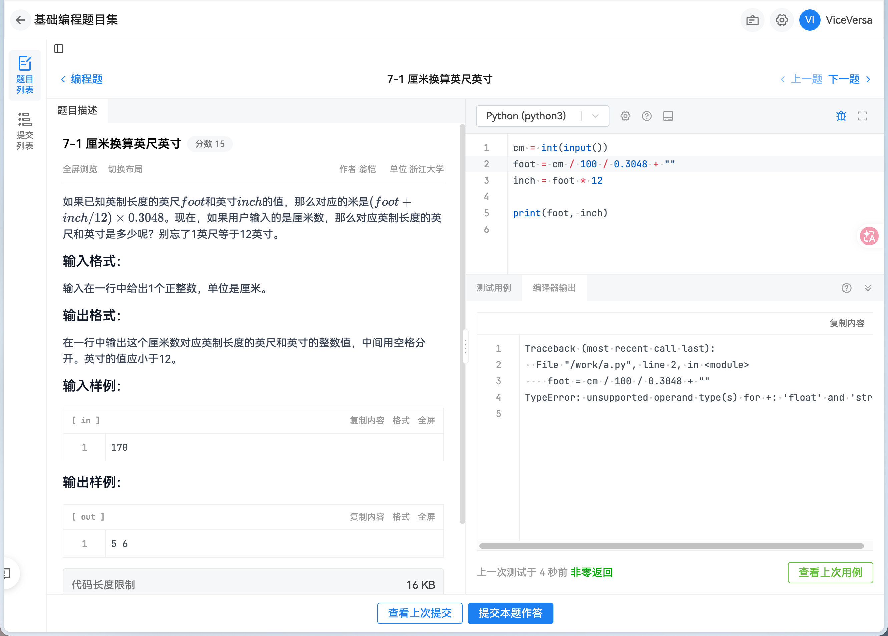
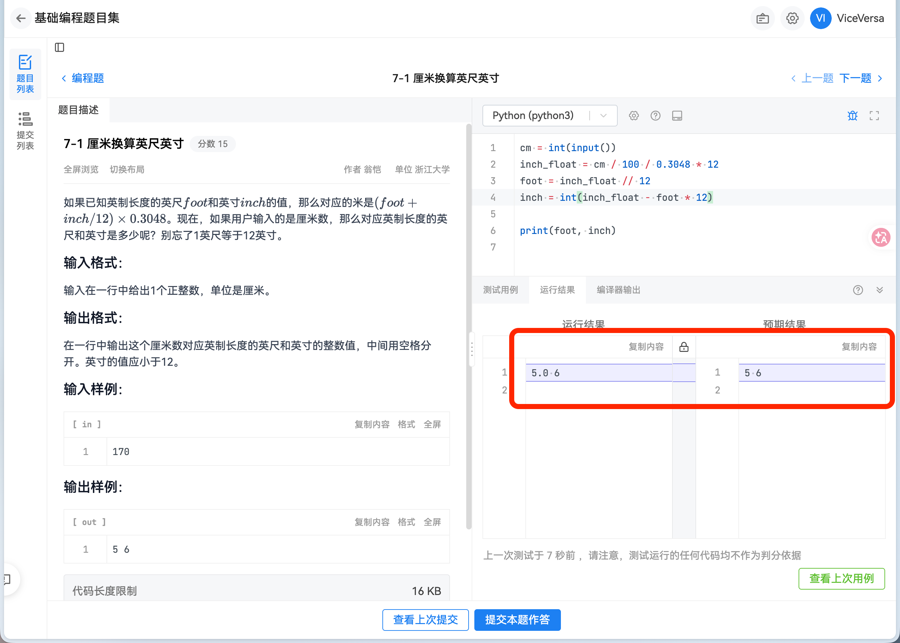
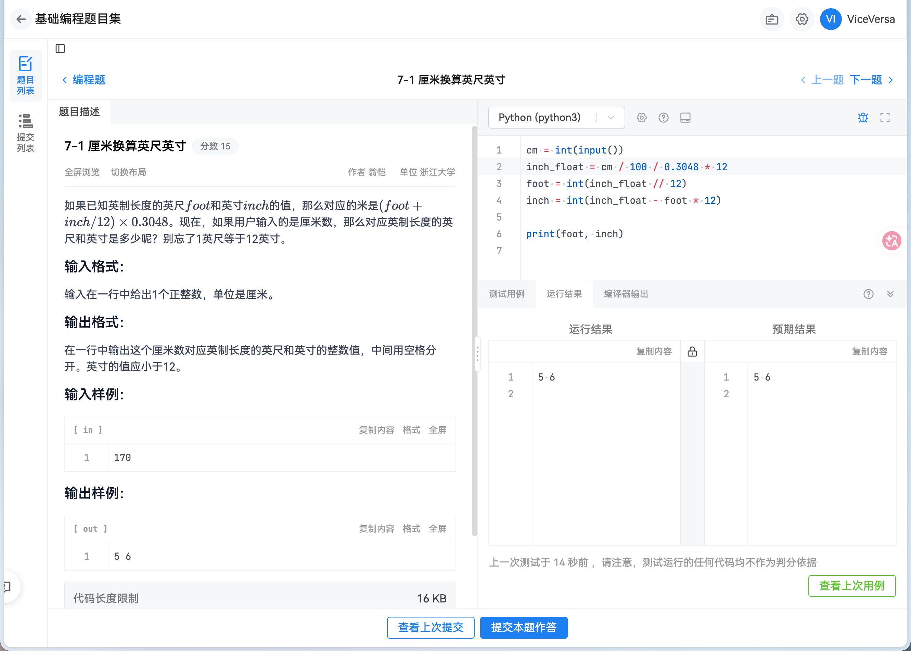

# 基础知识

## 目录

- [输入、输出与字符串](./io-string.md)

## PTA 测试方法

!!! warning "注意"

    **下面讲述的 PTA 测试方法是所有人都必须掌握的**.

对于任意一道**编程题**，右侧写代码的部分的右上角有一个**小虫子图标**，右下角有一个**向上的小箭头**。点击这两个按键的任何一个按键都可以得到这样的界面：

这里默认会将题目提供的输入样例作为题目的输入，点击**运行测试**按钮之后，PTA 会将你的代码运行起来，并且将运行结果显示在**输出**的部分，如果你的代码不幸错误，就会有下面的编译器输出：

这时测试区多出了**编译器输出**一栏，里面以 `Traceback` 开头的几行是 Python 的报错信息；底部还写着“非零返回”.

程序运行结束时，会向操作系统交回一个整数，称为退出状态（exit status）. 按照约定，退出状态为 0 表示程序正常结束，不为 0 表示程序异常终止. “非零返回”这个叫法来自 C、C++ 这类语言：它们的程序主体通常以一句 `return 0;` 结尾，返回的这个 0 就是退出状态，“返回”二字指的就是它. “编译器输出”这个名字也来自这类要先编译才能运行的语言. Python 程序不需要写这一句，退出状态由 Python 解释器负责：程序正常运行到最后，退出状态为 0；程序中途报错，解释器会先打印报错信息，再[以非零的退出状态结束程序](https://docs.python.org/zh-cn/3/tutorial/appendix.html#error-handling). 所以对 Python 程序来说，**非零返回就是程序报错了**，具体是什么错误，要看编译器输出中的报错信息. 提交之后，某个测试点的结果是“非零返回”，也是同样的意思：程序在这个测试点的输入下报错了.

找到原因之后，删去 `+ ""`，顺便改写换算的过程，再次运行测试. 这次没有报错，测试区多出了**运行结果**一栏：

左边是程序的运行结果，右边是预期结果，也就是题目的输出样例. **两边不一致的行会用底色标出，空格显示为 `·`，多一个或少一个空格都看得出来**. 这里程序输出的是 `5.0 6`，预期结果却是 `5 6`. 可见程序没有报错，不等于答案正确：PTA 比较的是程序输出的文字，`5.0` 和 `5` 是不同的文字.

修改第 3 行，再次运行测试，运行结果与预期结果完全一致：

最后留意测试区底部的提示：测试运行的任何代码均不作为判分依据. 运行测试只是给我们自己检查用的，并不算提交；确认无误后，还要点击下方的**提交本题作答**，这道题才会被判分. 样例通过也不代表提交一定能通过.
